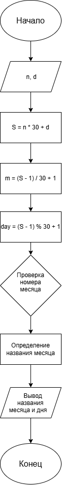

# Лабораторная работа 7

## Условие задачи

С января 2000 года по некоторый день прошло `n` месяцев и `d` дней. Определить название месяца этого дня. Предусмотреть возможность задания другого числа дней.

## 1. Алгоритм и блок-схема

### Алгоритм

1. **Начало**

2. Ввести количество месяцев `n`, прошедших с января 2000 года.

3. Ввести количество дней `d`, прошедших после этих месяцев.

4. Вычислить общее количество дней, используя упрощённое условие, что в каждом месяце 30 дней:

   `S = n * 30 + d`

5. Определить номер месяца:

   `m = (S - 1) / 30 + 1`

6. Определить день месяца:

   `day = (S - 1) % 30 + 1`

7. По номеру месяца определить его название.

8. Вывести название месяца и день.

9. **Конец**

### Блок-схема


## 2. Реализация программы

```c
#include <stdio.h>
#include <locale.h>

int main()
{
    setlocale(LC_ALL, "RUS");
    int n, d, S, m, day;

    const char *months[] = {
        "Январь", "Февраль", "Март", "Апрель",
        "Май", "Июнь", "Июль", "Август",
        "Сентябрь", "Октябрь", "Ноябрь", "Декабрь"
    };

    printf("Введите количество месяцев n: ");
    scanf("%d", &n);

    printf("Введите количество дней d: ");
    scanf("%d", &d);

    S = n * 30 + d;

    m = (S - 1) / 30 + 1;
    day = (S - 1) % 30 + 1;

    printf("День: %d\n", day);
    printf("Месяц: %s\n", months[(m - 1) % 12]);

    return 0;
}
```

## 3. Результаты работы программы

Для проверки программы зададим следующие значения:

- `n = 2`
- `d = 15`

После запуска программы получаем:

```text
Введите количество месяцев n: 2
Введите количество дней d: 15
День: 15
Месяц: Март
```

### Расчёт

Вычислим общее количество дней:

`S = 2 * 30 + 15 = 75`

Определим номер месяца:

`m = (75 - 1) / 30 + 1 = 3`

Определим день месяца:

`day = (75 - 1) % 30 + 1 = 15`

Третий месяц года — март.

Таким образом, программа определяет месяц и день по введённым значениям.

**Примечание:** в программе используется упрощение, при котором каждый месяц считается равным 30 дням. Поэтому результат не соответствует реальному календарю во всех случаях.

## 4. Информация о разработчике

**Фамилия:** Гусакова

**Имя:** Ксения

**Группа:** БИЦТ-261
